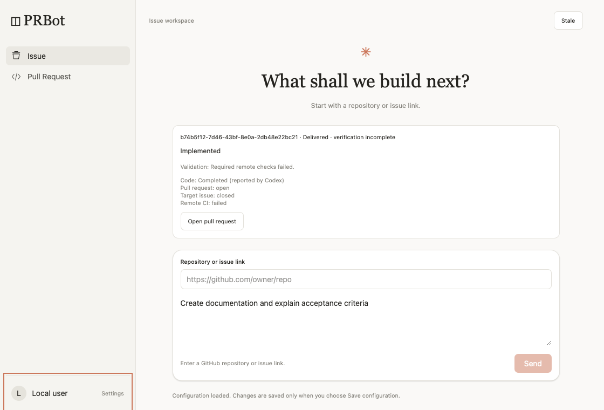
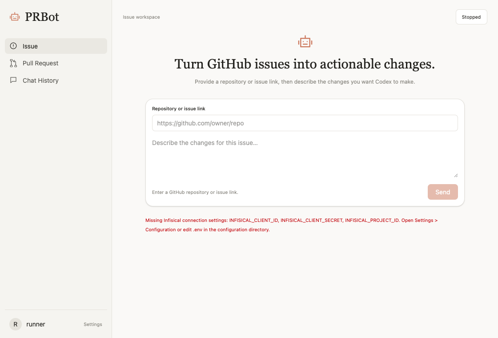
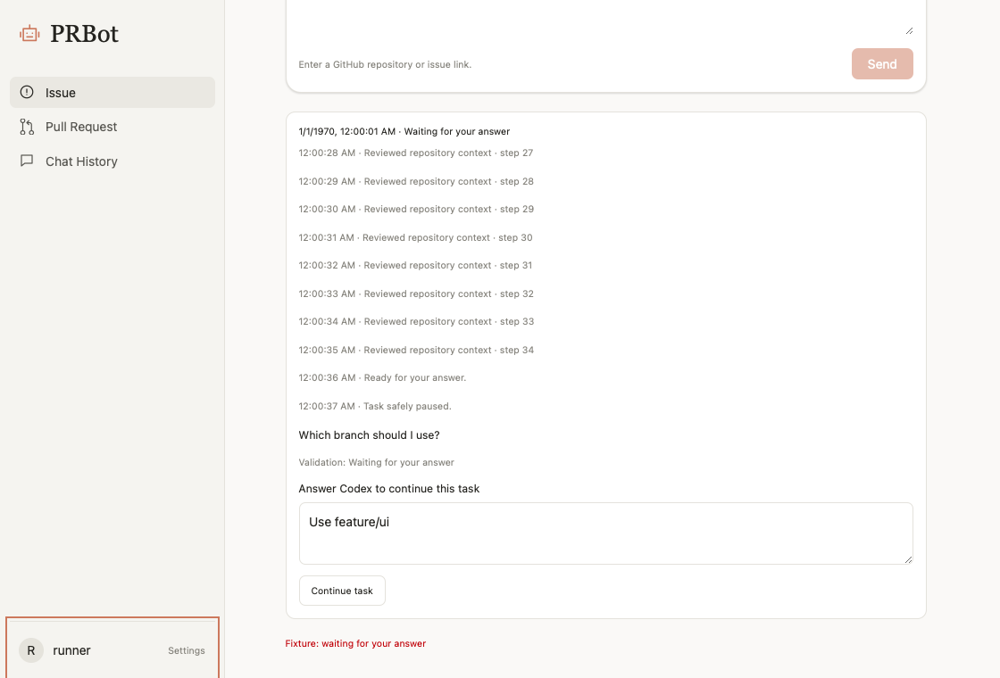
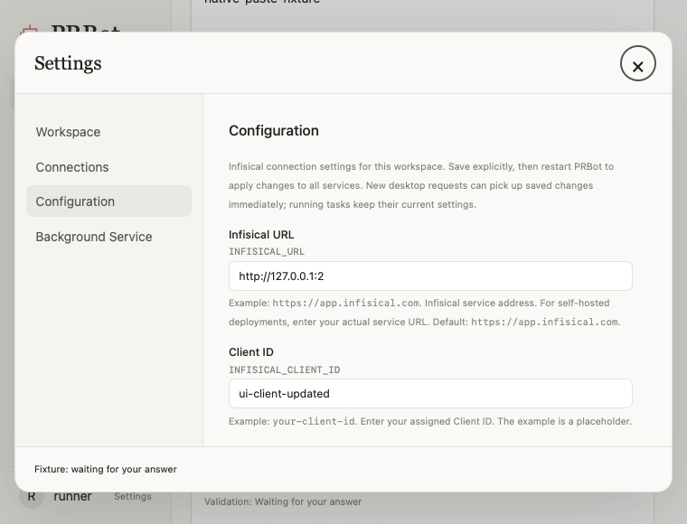

# Issue #11 桌面交互交付记录

基准：`6ab1b5c`，分支：`feature/issue-11-desktop-interactions`。本地没有编译、构建、源码测试或冒烟；只做 AST、Ruff 和差异检查。所有执行验证都在 GitHub Actions 的 macOS 14 上完成。

## 七项需求与实际位置

| 需求 | 修改位置 | 实现及边界 |
| --- | --- | --- |
| FR-01 执行反馈、回答、历史 | `src/prbot/sdk_worker.py:27`、`:48`，`codex_adapter.py:115`，`conversation_service.py:154`、`:248`、`:269`、`:333`、`:370`、`:526`，`desktop.py:275`，`frontend/src/App.tsx:12`、`components/TaskFeed.tsx:4` | Worker 输出 v1 NDJSON；控制器逐行处理；只允许状态、过滤后的助理说明和明确问题。原任务保存提问和多轮答案、重启恢复、回答幂等和 actor/source 校验。Chat History 独立浏览三类历史及具体会话；私人聊天使用只读沙箱，不注入 GitHub Token、不进入交付验证。 |
| FR-02 输出位置、顺序、滚动 | `frontend/src/App.tsx:68`，`components/TaskFeed.tsx:4`，`style.css:51` | 输入框在执行区上方；事件有时间和稳定序号。查看旧日志不自动跳底，在底部附近才跟随。消息已在历史展示时不重复展示同一最终结果。 |
| FR-03 图标 | `frontend/src/components/Icon.tsx:2`、`Sidebar.tsx:5`、`EmptyState.tsx:8` | 统一 24×24 SVG、1.6 线宽和 currentColor。Issue 用圆形问题图标、PR 用分支连线、品牌用机器人。只更新界面品牌；检查 `packaging/PRBot.spec` 确认前端资源随包，未修改 Dock / Finder 图标。 |
| FR-04 原生粘贴 | `src/prbot/desktop.py:351`，`frontend/src/bridge.ts:3`，`components/SettingsPanel.tsx:63`，`src/prbot/ui_check.py:129` | 原生窗口加入标准 Edit 菜单，通过响应链分派 Cmd+V / Cmd+C / Cmd+X / Cmd+A；后台请求不再禁用输入框。远端实际验证文本、密码、URL 和多行控件粘贴后的 React 值及焦点。 |
| FR-05 关闭按钮焦点 | `frontend/src/components/SettingsPanel.tsx:68`，`style.css:47` | 原因是 dialog 初始聚焦按钮叠加全局橙色 focus-visible。关闭按钮改为圆形交互区和深色圆形键盘焦点；全局焦点提示保留；未保存确认流程保留。 |
| FR-06 首页文案 | `frontend/src/components/EmptyState.tsx:3`、`Composer.tsx:9` | 分别使用需求建议的 Issue、PR 标题说明，输入提示对应实际操作；私人会话明确说明历史保存和发布边界。 |
| FR-07 卡顿与刷新 | `frontend/src/bridge.ts:3`、`App.tsx:48`，`components/SettingsPanel.tsx:63`，`src/prbot/desktop.py:164`、`:217`、`:326` | Connections / history / tasks / ready 是后台读取，不占用用户操作锁；原生状态读取从 AppKit 主线程移到后台，响应使用缓存。按动作去重和关联回复、旧任务快照保护、切换历史请求排队；数据未变则保留 React 状态身份。连接失败保留旧数据和错误提示。 |

`conversation_store.py` 的 Upstash 数据结构、原子容量限制和分页保持兼容。首次执行的助理消息仍使用旧 ID；回答后的轮次采用后缀，避免覆盖旧问题，同时保持原有提供商验收清理逻辑兼容。SQLite 只新增事件和答案表，不删除既有记录。

## SDK 能力核对与技术选择

锁定版本 `openai-codex==0.163.0` 与 `openai-codex-cli-bin==0.163.0`。核对了发布 wheel 的 `api.py`、`client.py`、`_run.py`：`thread.turn(...).stream()` 支持逐事件读取，`turn.run()` 会收集到结束；`thread_resume` 是已有持久化线程的恢复。`AgentMessageThreadItem.questions` 还可以携带原生问题及选项，Worker 会将其转换为同一等待回答流程。当前高层 `Codex` 构造器没有问答处理器参数，原有线程为 ephemeral 且临时 CODEX_HOME 在结束时销毁。

因此不声称能暂停恢复这个临时 SDK 线程。模型需要信息时用既有输出 schema 返回 `needs_clarification` 和明确问题；PRBot 将原任务置为等待回答。答案先保存到 Upstash，再以原 task ID、原目标、原需求及有序问题/答案重新排队。新 SDK 轮次明确要求检查已有仓库工作，避免重复交付。等待状态和问题不会因客户端重开丢失。已运行的任务关闭窗口后仍按既有规则中断，不自动重跑。

参考：[OpenAI Codex SDK 文档](https://developers.openai.com/codex/sdk/)。接口选择以本仓库锁定 wheel 为准，不依据其他版本或同步接口猜测。

安全边界：原始工具输出、命令、推理和 SDK stderr 不传前端；只转发白名单事件。助理说明先在 Worker 过滤敏感环境值、登录 Token，再由应用服务过滤配置凭据后写入日志和历史。最终结果也先过滤后保存。超时、取消仍杀掉整个 SDK 进程组并清理临时认证目录。ID Token 编辑框改为密码显示。

## 验证证据

- [首轮远端 CI 39974242241](https://github.com/C0verSnow/PRBot/actions/runs/39974242241)：前端检查和构建通过；183 个 Python 通过、1 个既有交付测试失败。失败暴露新增类型判断与适配器工厂替身不兼容，已移除该类型耦合，保留原测试断言。
- [远端 CI 39974450225](https://github.com/C0verSnow/PRBot/actions/runs/39974450225)：184 个 Python 测试、前端检查/构建、源码及安装包真实 WebKit、DMG 挂载复制和嵌入运行时均通过。已下载源码 UI JSON 核对 `ok=true` 并查看截图。
- 后续补充了 Worker 实际事件筛选测试、跨动作旧任务快照保护、历史切换请求排队、日志滚动和回答任务归属的 WebKit 验证。[功能验证 CI 39976685682](https://github.com/C0verSnow/PRBot/actions/runs/39976685682) 的 test / dmg 全通过：187 项 Python、前端检查构建、源码及安装包 WebKit、DMG 挂载复制和内嵌运行时。已下载并检查安装包 UI JSON 及三张截图。最后附加 JSON 转义凭据过滤回归后的 `8e4fdec` 也已通过 [最终功能 CI 39977233098](https://github.com/C0verSnow/PRBot/actions/runs/39977233098)：188 项 Python、前端检查构建、源码及安装包 WebKit、DMG 挂载复制与内置运行时全部成功；可选真实提供商 acceptance 按用户选择不执行。

自动化覆盖：原目标及同任务回答、其他 actor/source 拒绝访问、重复回答、归档失败不继续、重启后等待状态、不同轮次结果不覆盖、私人聊天不调用 GitHub 验证、超时分类、事件凭据过滤、输出数量限制、最终结果前收到事件、真实 SDK 初始化和已有 GitHub / Telegram 回归。

真实 macOS 检查：使用 AppKit 创建 Command+V 键盘等价事件，经实际 Edit 菜单及 WKWebView 响应链粘贴；覆盖六个配置字段、Token 密码框、Composer 多行框。模拟慢连接同时验证即时切页、草稿/焦点/DOM 身份保留、重复后台数据不改动 Settings DOM、配置保存重载、关闭确认和最小窗口。滚动和问答截图中的任务使用明确的测试 fixture，不冒充真实付费 Codex 任务。

## 截图与限制

改动前使用基准分支已有的远端截图：

改动后的真实安装包 WebKit 截图（`7b64318`，[CI 39976685682](https://github.com/C0verSnow/PRBot/actions/runs/39976685682) 的 test / dmg 全通过，工件 `PRBot-ui.json` 为 `ok=true`）：

首页截图使用全新测试 HOME，红色提示表示没有配置 Infisical 测试连接。执行区使用有明确 fixture 提示的模拟任务；日期从 Unix 1 开始，绝不作为付费 SDK 执行证据。截图原文件直接来自远端安装包工件，未重绘或修改。

本次不声称已经完成用户实际账号的付费 SDK 多轮问答和真实服务断线重连验收；这些需要专门的提供商 acceptance 环境，不能用模拟任务截图替代。已查询 Actions Secret 配置，`PRBOT_ACCEPTANCE_BOOTSTRAP` 和 `PRBOT_ACCEPTANCE_CODEX_AUTH` 均未配置；一次手动验收流程在执行前被并发 PR 流水线取消，不能算验收。用户明确回复“没有，先交付 PR 并注明验收待办”。真实提供商多轮和服务断线重连保留待办，没有上传本机私人 Codex 登录。键盘菜单粘贴是远端真实 AppKit/WebKit 验证，未在用户当前安装包上操作。

Pull Request：[PR #12](https://github.com/C0verSnow/PRBot/pull/12)。

Issue #11 要求验收并完成必要合并流程后才能关闭；创建 PR 不提前关闭，也不自动合并。当前保持打开供维护者审查。

## 后续验收：组织 Secret 与 Infisical

用户已补充组织级六项 `INFISICAL_*` Secret，并授权从 Infisical 读取完整 `PRBOT_ACCEPTANCE_CODEX_AUTH`。工作流按用户提供的路径注入六项配置，空的可选项沿用应用默认值，兼容此前直接注入 auth 和 JSON bootstrap 的方式。没有上传本机登录。

新增远端验收：真实 SDK 首轮提问 → 重新打开会话服务恢复等待状态 → 原 task ID 保存回答 → 第二轮用回答中的随机标记写入临时文件并读回。第二轮 SDK 返回后，测试专用 CONNECT 隧道实际切断客户端到真实 Redis 的 HTTPS 通路，验证 `save_pending` 保留结果；恢复通路后 Retry 仅保存、不重跑 SDK，并从 Redis 恢复四条消息。隧道只接受配置的服务目标，不解密 TLS，也不修改 Redis 的真实配置或凭据。

该检查验证客户端传输断线恢复，不等同于提供商整体故障或桌面自动连接状态监控。自动化回归覆盖组织 Secret 空项、Infisical auth 选择、旧配置兼容、本地执行拒绝，以及真实 TCP 隧道已有连接中断和重新连接。执行结果将在远端流程完成后补充。

### 真实配置暴露的路径过滤缺陷

真实验收在 SDK 初始化报 `FileNotFoundError`。安全分类确认缺失的是 workspace；[修复前远端复现 40053125319](https://github.com/C0verSnow/PRBot/actions/runs/40053125319) 显示 194 项通过、两项新增回归失败：`INFISICAL_SECRET_PATH=/` 被凭据识别规则误判，导致任务 JSON 中目录和 URL 的每个 `/` 都被替换为 `[REDACTED]`。较长的 Infisical 路径同样会被错误遮蔽。

`ConversationService.clean` 现在明确排除非凭据字段 `INFISICAL_SECRET_PATH`。提交时只过滤用户文本，保留经校验的仓库路由和本机选择的文件系统元数据；不会因凭据恰好匹配路径片段而改变执行目标。真实 Client Secret、Token、原文和 JSON 转义形式的过滤继续保留。安全错误证据只输出文件目标和来源枚举，不输出真实路径、异常正文或凭据。
