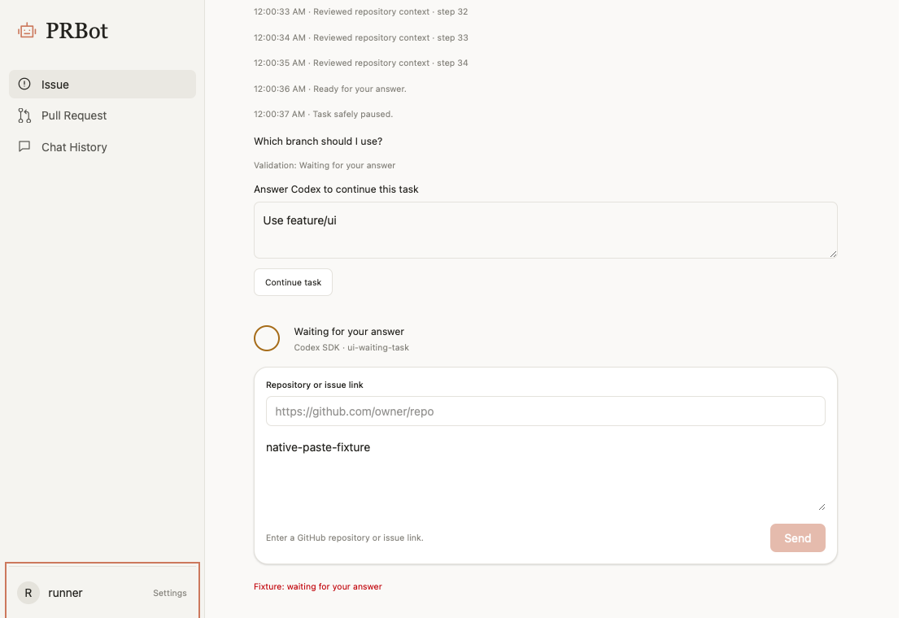

# Issue #13 源码定位与实施记录

定位基准：`90d3d331f2a96e9c3031768f4c2cd16bc77fb83f`。以下为修改前的位置，交付位置见 PR。

## 已确认的调用链和根因

- `src/prbot/conversation_store.py` `save`：52–59。
- `src/prbot/conversation_store.py` `history`：61–79。
- `src/prbot/telegram_conversations.py` `send_results`：114–167。
- `src/prbot/telegram_conversations.py` `archive_update`：19–47。
- `src/prbot/telegram_conversations.py` `handle_async`：49–111。
- `src/prbot/conversation_service.py` `submit`：156–220。
- `src/prbot/conversation_service.py` `answer`：271–318。
- `src/prbot/conversation_service.py` `save_result`：335–362。
- `src/prbot/conversation_service.py` `execute`：372–531。
- `src/prbot/conversation_service.py` `continuation`：533–556。
- `src/prbot/conversation_service.py` `run`：638–677。
- `src/prbot/secrets.py` `load_secrets`：29–82。
- `src/prbot/telegram_client.py` `run`：121–199。
- `src/prbot/telegram_client.py` `handle`：61–118。
- `src/prbot/sdk_worker.py` `run`：182–250。

- FR-01：App.tsx 61–67 为历史容器，TaskResult 解析结果；历史 article 和 TaskFeed 嵌套边框并重复呈现事件。影响历史分页、任务选择；补远程 DOM 检查。
- FR-02：Telegram archive_update 用当前 update ID 冒充 task_id，多轮创建无法归为一个任务；conversation_store 的 HSCAN 不保证全局分页顺序。Receiver 在 dispatch 前归档，需先建立持久化路由再归档，写失败不得接受执行。影响历史读取、提交重试；补乱序、重启、容量与隔离测试。
- FR-03：handle_async 只比较启动时的单 Actor ID；load_secrets 已支持 refresh。复用此接口，增加失效默认拒绝、60 秒撤销期限和 5 秒查询限流；补授权新增、撤销和异常测试。
- FR-04：handle_async 无 answer 调用，send_results 仅按 id 去重；answer 虽有 CAS，但在 CAS 之前写远程历史可能留下并发失败回答。补持久化回复预留和原任务继续执行，按 task+round+status 通知；补多任务、并发、重试、重启回归。
- FR-05：SettingsPanel.tsx 27 调用 showModal，67–68 首个可聚焦元素为关闭按钮；自动聚焦导致高亮为待浏览器验证假设。改为标题初始焦点并保留原触发器恢复；用远程 WKWebView 实测。
- FR-06：App.tsx 68–69 Composer 在 TaskFeed 之前；SettingsPanel 的 service-core 使用 Telegram state。增加当前任务选择和真实任务动画，保留设置内静态连接信息。

## 测试入口

`tests/test_unified_conversations.py`、现有 test_tasks/test_interactions/test_receiver；`src/prbot/ui_check.py` 为远程 WKWebView 交互验收。仅在 GitHub Actions 执行测试、前端构建和 DMG 打包。

## 数据模型与恢复约定

每条 Redis 消息保留 message_id、conversation_id、task_id、source、actor_id、role、content、created_at、sequence；新记录增加 mode，Telegram 增加 logical_order。同一个任务的创建命令、链接、说明、澄清与回答共享从 /FinishIssue 开始分配的任务 ID。会话 ID 仍保持原有哈希格式，跨模式创建消息通过 task_id 聚合。

继续沿用 Redis v1 hash 和原子 Lua 幂等写入；10 MB 是消息字段和值的 UTF-8 容量预算，不含 Redis 服务自身索引和对象开销。不会自动到期或自动删旧记录，满额明确拒绝写入，需管理员导出后清理或扩容。新历史入口扫描这个有上限的存储，先去重排序，再按消息锚点分页；旧 HSCAN 接口保留供兼容调用。排序使用事件时间、Telegram update ID 与用户/助手阶段；重试沿用本地日志保存的时间，不使用重试到达时间重新排序。旧数据缺少 mode 时使用会话哈希和本地任务记录补齐；无法判断的旧 Telegram 游离消息不会硬塞进其他任务，已有错误归属无法凭空恢复。

SQLite 是执行日志，Redis 是跨客户端可见历史。telegram_updates 先保存可信路由与对话快照，用户消息写入 Redis 成功后才允许提交任务。回复及任务提交使用相同幂等键，网络失败由 Receiver 保留 update offset 并重试，连续失败五次会明确暂停服务，修复连接后重启。pending_answers 在远程写入前预留当前回答，失败后只有原 reply_id 可重试；本地提交完成后才入队。结果写失败保留 save_pending，后台只重试归档，不重复执行 SDK。telegram_notices 按任务、回答轮次、状态记录通知及 Telegram message_id，临时发送失败按 3–60 秒退避重试；永久拒绝保留 delivered=-1 供诊断，不假报送达。Telegram sendMessage 没有幂等键，已发送但响应丢失时仍可能重复通知，任务和回答本身不会因此重复执行。

进程重启保留 SQLite 时可恢复草稿、待澄清任务、未发送通知、预留回答及归档重试。正在执行的任务标记 interrupted，必须先检查仓库再继续，不自动重做可能已发生的外部操作。Redis 独立保存历史，不保存可直接重放的完整本机执行环境；丢失本地 SQLite 后只能恢复浏览记录，不能自动重建执行任务。备份时需同时保存 SQLite 及对应工作目录。

Codex SDK 的现有实现每次调用 thread_start，本次没有假装实现原生 Thread resume：继续任务时新建 Thread，注入原任务描述、按 task_id 过滤的历史、全部澄清问题及回答，保留 PRBot task_id。任何“新建PR5”之类回答都会进入真实 invoke prompt 的 continuation.answers。继续前要求先检查已完成的外部操作。

## 授权与隔离

Infisical 的 PRBOT_TELEGRAM_ACTOR_ID 接受单个数字 ID 或逗号/空白分隔的多个数字 ID，例如 `123,456`，任意无效项使整份配置拒绝授权。已知授权最多缓存 60 秒，未知用户立即尝试刷新；成功或失败查询之间至少间隔 5 秒，共用锁合并并发查询。两次 HTTP 请求各最多 5 秒，查询或解析失败清空授权，不回退到旧授权。撤销在缓存到期后的下一次受保护请求生效；不影响已经获准执行的任务。

桌面历史读取的本地用户由原生宿主提供，Telegram Actor ID 只读取服务端 Infisical 配置。界面不能传入任意 Actor ID 获得记录。Telegram 回答需同时匹配 task_id、source 和 chat:user:thread；多个等待任务必须显式选择，回复通知时通过保存的 message_id 关联。桌面展示已授权 Telegram 历史和真实任务状态，但不替 Telegram 用户回答任务。

## 桌面交互

历史与主任务使用同样的无边框消息流，结构化结果由 TaskResult 解析，已归档结果不在任务区域重复显示。保留工作区、会话选择、刷新和加载更多。刷新会替换第一页，分页以 conversation_id/message_id 为锚点，避免重复合并。Codex 真实状态位于输入区上方，多个任务可选择当前任务，支持空闲、排队、执行、等待回答、成功、失败、中断及归档待重试；遵守系统减少动态效果设置。Telegram 连接信息保留在 Settings，使用静态图标。

Settings 初始焦点放到标题，关闭按钮保留 focus-visible 和键盘操作；关闭时恢复打开前的实际触发元素。标题只在程序聚焦时隐藏轮廓，不移除全局键盘焦点提示。

## 验证记录

本地只做 Python AST 语法阅读检查与 git diff --check；未运行本地测试、构建或编译。系统 Python 没有预装 ruff，后续用独立二进制执行静态检查。完整单元测试、TypeScript 检查、前端构建、真实 WKWebView 焦点/消息流/状态检查及 DMG 安装验收交由现有 GitHub Actions。

首次远端 CI 40058305329 的 215 个测试、Ruff、TypeScript/Vite 已通过，WKWebView 小窗口留白断言失败（截图中弹窗左侧仅约 9px）。宽度限制改用包含块百分比，保留原断言。补充检查选择提示和 /id 回复归档、旧通知轮次拒绝及授权缓存独立性。新增 acceptance_telegram.py，使用 Telegram Update 样本、真实 Redis 和真实 SDK 验证创建→澄清→回答→原任务继续→桌面读取历史；不调用真实 Telegram sendMessage。

## 真实提供商验收

[远程验收 40064639370](https://github.com/C0verSnow/PRBot/actions/runs/40064639370) 对后端提交 `a2d1054fb20c01447331cb86355476e44693a8b6` 完整通过 test、dmg、acceptance：220 个测试、Ruff、TypeScript/Vite、源码和安装版 WKWebView、DMG 挂载复制、签名与内嵌 SDK 检查。脱敏结果见 [provider-evidence.json](evidence/issue-13/provider-evidence.json)。

真实 Infisical/Redis/SDK 验收确认主机文件写入和命令、任务幂等、重启历史、真实澄清与回答、Redis 断网恢复且不重跑 SDK；新增 Telegram 适配器测试确认原任务收到回答、重复回答幂等、完整 10 条创建与澄清消息可在桌面读取。该测试使用合成 Telegram Update 与临时授权 Actor，不向真实聊天发消息，也没有修改 Infisical 中的生产授权列表；动态授权新增/撤销/失败/限流由确定性的回归覆盖。

后续仅调整状态指示器紧邻输入框的位置，并补旧 Telegram 消息缺少 mode 时按会话哈希读取的兼容回归；没有更改 SDK 执行或提供商凭据机制。最终提交的完整 223 项测试及安装版位置断言，以 PR #14 最新 Checks 为准，不能把前一提交的 220 项结果冒充为新测试已通过。

## 最终代码位置

行号对应本次交付的代码；完整提交 SHA 记录于 PR #14。定位基准的完整 SHA 和修改前范围见本文开头。

| 需求 | 修改位置与调用关系 | 影响和验证 |
| --- | --- | --- |
| FR-01 | frontend/src/App.tsx 35–42、57–75：历史合并、会话选择、消息流；frontend/src/components/TaskFeed.tsx 4–37：复用结果渲染，历史中不重复事件 | 历史刷新、分页、结果去重；远程 WKWebView 断言 |
| FR-02 | src/prbot/conversation_store.py history 61–86、messages 88–116；src/prbot/conversation_service.py desktop_history 281–346；src/prbot/telegram_conversations.py archive_update 22–58、record_response 60–85 | v1 兼容、先排序后分页、Actor 隔离；重启、同秒乱序、写失败回归 |
| FR-03 | src/prbot/telegram_auth.py actor_ids 10–14、allows 28–46 → src/prbot/secrets.py load_secrets；handle_async 87–209 校验身份后才路由 | 多 ID、新增/撤销、失败拒绝、请求合并；旧任务配置不改变授权缓存 |
| FR-04 | src/prbot/telegram_conversations.py handle_async 87–209、process 211–265、send_results 268–343 → ConversationService.answer 369–443 → execute 495–668 | 同任务继续、多任务选择、通知轮次、持久化回答预留；src/prbot/acceptance_telegram.py check_telegram 21–131 |
| FR-05 | frontend/src/components/SettingsPanel.tsx 16–35、75–76：标题初始焦点与原触发器恢复；frontend/src/style.css 30、47–59：小窗口留白、focus-visible | 真实 WKWebView 首次打开、关闭恢复、小窗口滚动；不移除全局焦点提示 |
| FR-06 | frontend/src/App.tsx 47–58、72–75 → frontend/src/components/TaskStatus.tsx 2–14；frontend/src/components/SettingsPanel.tsx 108 改静态连接图标 | 当前任务真实状态位于输入区上方，轮询沿用 2 秒，动画支持减少动态效果 |

测试实现集中于 `tests/test_unified_conversations.py`；原有 tasks、interactions、receiver 等回归保留。

状态紧邻输入框的源码窗口验收：提交 `c5be7d4935188d1c8269865b97320c0e1b0019a3` 的 [CI 40064879328](https://github.com/C0verSnow/PRBot/actions/runs/40064879328) 已通过该位置断言，结果见 [source-ui.json](evidence/issue-13/source-ui.json)。下图为远程真实 WKWebView 使用测试任务显示的界面，不是设计稿或真实用户记录。

桌面轮询通过 `ConversationService.visible_tasks()` 读取同一服务端授权范围的 Telegram 任务，只读展示真实状态；TaskFeed 标注回 Telegram 回复，服务端 answer 仍校验 actor/source，桌面无法代答。新增两项任务归属回归及真实窗口选择/只读断言。
