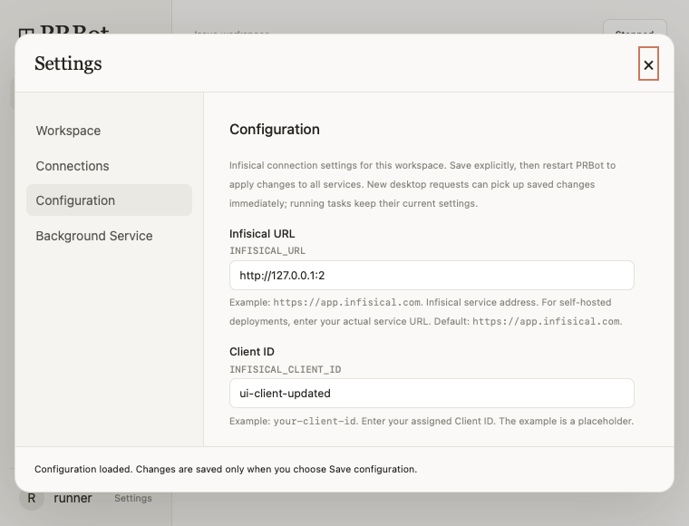

# PR #10：配置填写与示例

本次按最新评论 [#6362754969](https://github.com/C0verSnow/PRBot/pull/10#issuecomment-6362754969) 完成六个 Infisical 字段的填写提示。

## 改动

- `frontend/src/components/SettingsPanel.tsx`：固定键与字段映射，显示友好名称、完整配置键、常驻示例和说明；通过 aria-describedby 关联说明。已有值时仍可查看示例；既有默认值另标 Default。
- 示例不进入表单状态。Client Secret 保持密码输入，已保存值不回显，留空保留提示与示例同时展示。
- 复用原有加载、草稿、显式保存和错误处理，未更改后端校验、环境优先级或私有文件写入方式。
- `tests/test_settings.py`：逐字段保存和重载、修改与空 Secret 保留；复用原环境优先级、校验失败和真实写入失败回归。
- `src/prbot/ui_check.py`：源码及安装包的原生 WebKit 检查六字段标签、示例、已有值时的说明、逐字段编辑、切换分区和后台刷新保留草稿、提交键值、保存失败保留、真实路径校验失败、保存及重载、Secret 留空状态和最小窗口滚动。
- WebKit 写入失败使用受控失败响应，后端测试才复现真实写入失败，不混淆两者。

## 修改位置

以下行号以 `c95f472` 为准：

| 文件 | 修改位置 |
| --- | --- |
| frontend/src/components/SettingsPanel.tsx | 4–11：六字段说明表；83–96：字段、标签、示例与保存按钮 |
| src/prbot/ui_check.py | 65–111：小窗口检查；269–375：六字段交互与重载检查 |
| tests/test_settings.py | 145–180：逐字段持久化与 Secret 保留回归 |

## 验证

本地仅 AST、Ruff、差异检查通过，没有本地编译、构建、源码测试或冒烟运行。远端 [CI #39939429469](https://github.com/C0verSnow/PRBot/actions/runs/39939429469) 的 test 已通过，源码 WebKit JSON 为 `ok=true`，截图已核对：已有值的字段仍显示完整配置键和常驻示例，最小窗口可滚动到六字段和保存按钮。test 和 dmg 均成功：176 个 Python 测试、Ruff、前端类型检查及构建、源码及安装包 WebKit、DMG 挂载复制和内置运行时验证。安装包 UI JSON 同为 `ok=true`，Configuration 小窗口截图已目视核对。真实提供商 acceptance 按工作流条件跳过，本次不声称重跑真实服务认证。

首轮 `6510db3` 的第二轮窗口检查沿用了第一轮的 `ok` 状态，截图过早，不作为小窗口验收证据。`c95f472` 先重置 `pending`，待检查完成并绘制后再截图；后续记录仅引用修正后的运行。

## 下载与界面证据

- [DMG 安装包](https://github.com/C0verSnow/PRBot/actions/runs/39939429469/artifacts/12494789042)
- [176 个测试结果 XML](https://github.com/C0verSnow/PRBot/actions/runs/39939429469/artifacts/12494948452)
- [源码 UI JSON 和截图](https://github.com/C0verSnow/PRBot/actions/runs/39939429469/artifacts/12494928589)
- [安装包 UI JSON 和截图](https://github.com/C0verSnow/PRBot/actions/runs/39939429469/artifacts/12495018245)

截图展示上半部分；远端交互检查会逐项滚动至全部六字段及 Save configuration，验证说明、值映射和控件可达。
