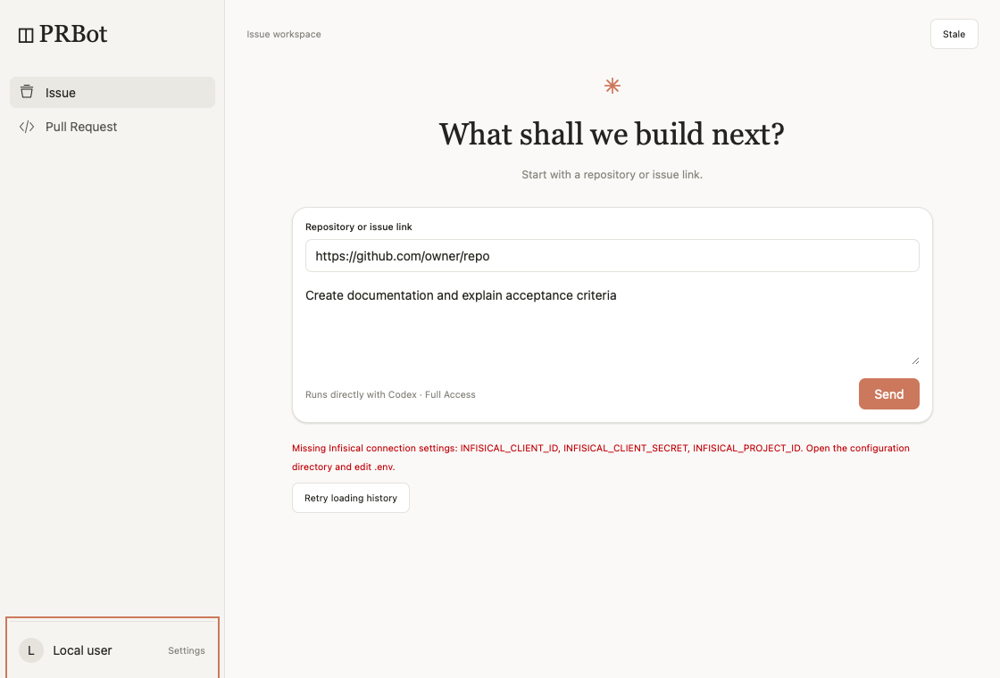
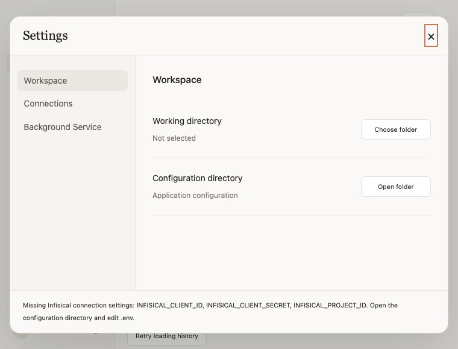
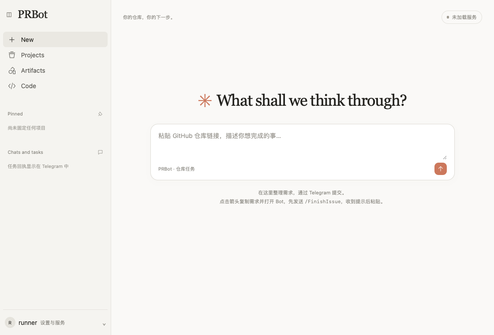

# Issue #9 验收记录

功能主提交 `6d990d3c26a65be6ceb1af25d0e40816d78362e9` 已通过[远端 CI #39698835402](https://github.com/C0verSnow/PRBot/actions/runs/39698835402)。后续的配置目录绑定修复及追加回归，以 [PR #10 的最新 Checks](https://github.com/C0verSnow/PRBot/pull/10/checks) 为准。

## 已实际核对的结果

- 114 项 Python 回归通过，覆盖共享提交、失败保留、归档重试不重复执行、进程互斥、崩溃恢复、身份隔离、配置迁移和真实 SDK 初始化。
- React 类型检查、前端构建和 Ruff 通过。
- 真实原生 WebKit 在 1120×760 和 760×580 检查两种模式、草稿保留、三项设置、工作空间两行按钮、状态展示、键盘焦点恢复及实际样式。
- DMG 已构建、挂载并复制；内置运行时、Infisical 缺失配置提示、当前工作路径、临时签名和复制后的真实窗口检查通过。[安装包窗口检查 JSON](evidence/issue-9/installed-ui.json) 为 `ok: true`。
- 真实 Infisical 读取和 Upstash Redis PING 通过。真实用户及助手消息保存后，通过新建的服务实例重新读取；请求重放没有再次调用 SDK。
- 真实 SDK 使用本机登录副本和有效 access token，完成工作目录以外的文件写入与宿主 shell 命令。结果由控制器读取实际文件核对，不只依赖模型自述。
- Redis 实际执行同一套 Lua 原子脚本，验证重复写入不增量、超限拒绝。生产应用数据预算为 10,000,000 字节；边界测试在独立临时键上使用小预算，未向数据库灌入 10 MB 测试数据。
- GitHub 认证读取成功。真实验收只做文件、命令和历史存储，不为验收创建额外 PR、不修改真实仓库、不向 Telegram 发消息。GitHub 交付的权限、PR 对应关系和远端检查另有回归与控制器核对。
- [真实服务验收 JSON](evidence/issue-9/provider-evidence.json) 中 `ok` 为 true，所有布尔断言均通过。测试只清理本轮产生的消息字段及临时键，不删除用户历史。





窗口截图使用无真实凭据的隔离配置，因此故意保留 Missing Infisical 提示，证明错误反馈可读；不是账号已连接的截图。真实连接和 SDK 证据来自独立远端验收任务。截图已经下载查看。

## 验收边界

本地只做代码阅读、静态语法、Ruff 和差异检查，没有编译、打包、执行源码测试或冒烟脚本。未更新本机已安装应用，不将远端 runner 验收说成本机实测。手动服务控制采用模拟回归和安装包状态检查，未在用户本机操作系统弹窗中逐项点击。正式 Developer ID 签名与 Apple 公证仍不在本轮范围。

首轮真实验收账户读取失败，原因是验收登录副本删除了 SDK 所需的 refresh_token 字段；改为保留字段但置空，使用仍有效的 access token，防止远端消耗本机的刷新令牌，之后真实 SDK 调用通过。未把失败那一轮算作成功。临时连接参数和登录副本使用 GitHub 加密 Secret 提供，验收结束后删除；密钥未进入仓库、明文日志、Redis 或公开产物。

---

## 旧版本历史记录

# PRBot v0.1.0 验收记录

目标设备：Apple Silicon Mac mini；本次 Issue #3 实测 macOS 27.0.1，兼容下限 macOS 14 的构建与安装包检查由远端 CI 覆盖。
交付性质：开发测试版，ad hoc 签名，无 Developer ID、无公证。

## 已有远端验证证据

源码提交：`86838e646f9d9e9e5e3a02b807901cfcf696183d`。

- [远端 CI #39519526726](https://github.com/C0verSnow/PRBot/actions/runs/39519526726)：静态检查通过，pytest **52 项通过**。
- 同一运行已构建 DMG，并通过挂载、复制、无外部 Python PATH 的内嵌运行时检查、无效配置停机检查和 ad hoc 签名完整性检查。
- [下载开发测试版工件](https://github.com/C0verSnow/PRBot/actions/runs/39519526726/artifacts/12309972621)，保留 30 天。
- DMG SHA-256：`19a88a519d7ae241f62238cbe0ff307dc4ccf5143e0bc9395842e486affefa0b`。
- 已将远端产物下载到本地 `dist/` 并核对 SHA-256；没有执行本地编译、测试或启动 app。

## 自动检查

CI 工作流为 `.github/workflows/ci.yml`，具体通过情况以对应提交的 Actions 结果为准。

| 检查 | 方式 |
| --- | --- |
| /id 私聊、群聊、匿名管理员 | pytest 合成 Telegram Update |
| 命令边界、其他 Bot、普通文本和未知命令 | pytest 路由测试 |
| 配置覆盖、错误值、权限和 Token 隐藏 | pytest 配置测试 |
| 持久化、重启去重、失败不算交付、重试预算 | pytest + 临时 SQLite |
| 网络恢复、Token 无效、polling 冲突 | mock Telegram API 测试 |
| LaunchAgent、停止、自启动、日志脱敏 | pytest + mock launchctl |
| 内嵌 Python、DMG 挂载复制和配置错误停机 | 远端 macOS CI 打包后检查 |

这些测试不使用真实 Token，也不代替目标设备验收。

## 早期版本的设备验收范围

| 对应标准 | 操作 | 结果 |
| --- | --- | --- |
| AC-01、02、03 | 下载 DMG，在未部署 Python 的 Mac 安装；验证缺 Token 提示 | 待验收 |
| AC-04、05、06、07 | 配置真实 Token，私聊和群组发送 /id、未知命令 | 待验收 |
| AC-08、09、13 | 关闭界面/终端、重新登录、主动停止 | 待验收 |
| AC-10、11、12 | 断网恢复、无效 Token、另一个实例争抢 polling | 待验收 |
| AC-14、15、16 | 检查日志无 Token、按手册卸载和全新安装 | 待验收 |
| 正式分发 | Developer ID 签名、公证与 Gatekeeper 首次启动 | 待提供证书并验收 |

以上为早期版本保留的独立验收项目；正式分发、公证、全新系统安装和完整故障演练未因本次功能验收而完成。Issue #3 的实际范围与证据见下文。

## Issue #3：FinishIssue 流程

开发分支：`feature/issue-3-finishissue`；起始提交：`376dabca4c9d37f12d5ecc6fcefa89a7e1f80f1a`。

### 远端检查与安装版

- 经核验并固定 SDK 与原生 runtime 为 0.163.0，来源和实际接口见[任务配置](任务配置.md)。
- [代码提交 97a5aef 的 CI](https://github.com/C0verSnow/PRBot/actions/runs/39534936596)：101 项测试通过，DMG 构建、挂载复制、签名和内嵌 SDK 无付费线程检查通过。
- 后续仅增加验收记录和失败、并发测试的提交 `38d02822b2334bafb2e4d516d82f090dcc04809d`：[CI #39535801545](https://github.com/C0verSnow/PRBot/actions/runs/39535801545) 为 102 项测试通过，DMG 检查成功；本机运行的应用代码与该提交相同。
- 工件编号 `12316209244`，下载 ZIP SHA-256 为 `898cef68dd4425be038c119dab9d62a8dd345426b97f4c10e1862aa45ede8a7c`；解压后另核对 SHA256SUMS 中的 DMG 哈希。
- 本次用户明确允许运行远端构建的应用做验收。安装到 `/Applications/PRBot.app`，签名完整性通过，复用已登录的 Plus 账号，启动检查成功。没有在本机安装项目依赖、编译、打包或运行源码测试。
- 原生“选择工作路径”文件夹选择器已实际操作，选择 `/Users/troy/Desktop/2`，任务分别建立在其 `PRBot-workspaces/<任务编号>` 下。原始仓库未提交内容保留。
- 不要求用户安装 Python、pip、Node 或修改 PATH。目标设备原有 Apple Command Line Tools Git；尚未验证完全不带 Git 的机器可执行仓库任务。

### 确定性回归范围

远端测试使用可替换适配器，覆盖路由、会话隔离、取消及超时、仓库与权限检查、SDK 失败与超时、并发限制、重复更新、回复发送重试、PR 结果核对、Issue 关闭失败、停止及恢复、工作目录隔离和认证文件清理。原生 SDK 检查不调用付费 turn，不对外创建 PR。真实账号流程单独记录，不能由 mock 测试代替。

### 真实 Telegram → Plus → GitHub

授权用户 `6190688941` 在 `@PRbyTroy_bot` 提交任务，目标仓库为 `C0verSnow/PRBot`。本次执行没有合并任何 PR。

- 首次试验 `614f7fa0021c4ea2` 产生[草稿 PR #6](https://github.com/C0verSnow/PRBot/pull/6)，Bot 将被后继 PR CI 替代的 push CI 取消误判为失败，没有虚报成功。已修复后继 CI 等待逻辑并增加回归；此轮不计验收通过。
- 重跑任务 `23c2e1ed465b4bc4` 产生[PR #7](https://github.com/C0verSnow/PRBot/pull/7)，起始 SHA 为 `376dabca4c9d37f12d5ecc6fcefa89a7e1f80f1a`，交付 SHA 为 `16d1460ffd1107fb82eb3b7e6e55dec61c7e9963`。根目录 `test.md` 为 `test done\n`，仅另改 README、使用手册和四象限 tasklist；每条记录包含 Unix 时间戳。
- 执行期间用户另发 `/id`，确认及时收到正确身份回复。
- 普通任务 [CI #39535674638](https://github.com/C0verSnow/PRBot/actions/runs/39535674638) 成功；PR #7 转为待审，任务为 succeeded，最终 Telegram 回执 delivered（1 次发送）。
- 关联 [Issue #5](https://github.com/C0verSnow/PRBot/issues/5) 的任务 `7f4621226e664be9` 在 SDK 执行阶段失败，未创建 PR，Issue 保持打开；失败回执 delivered。使用同一已安装应用与相同需求重放 SDK 执行成功，未执行 Git 写入，首次故障未复现；尚不能确定原始原因，不能计为关联交付流程通过。后续重跑证据见下一条。

- 关联重跑任务 `4c79692259a14494` 完整通过：起始 SHA `376dabca4c9d37f12d5ecc6fcefa89a7e1f80f1a`，交付 SHA `31b892125989e3412af03566d687c87dc21064ad`；[PR #8](https://github.com/C0verSnow/PRBot/pull/8) 已待审且未合并，[CI #39563456864](https://github.com/C0verSnow/PRBot/actions/runs/39563456864) 成功。`test_issue.md` 精确为 `issue done\n`，仅另改 README、手册和四象限 tasklist。Bot 已在 CI 成功后关闭 Issue #5。
- 关联任务最终 Telegram 回执 delivered，共 2 次发送尝试；回复重试期间保持同一成功任务、同一分支及 PR #8，没有重新执行交付。

重复 update 与发送失败后的副作用防重另由远端确定性回归覆盖，本次未向真实 Telegram 人工注入重复更新，不将其写成真实重放演练。普通仓库任务与关联 Issue 的两条真实流程均已从远端 DMG 安装版完成。


## PR #4 最新评论：启动账户检查

2026-10-21 使用已安装远端构建的运行时只读诊断，没有运行源码测试或本地编译：

```text
sdk-check: initialized=true, thread_started=true
account/read refreshToken=false: account present=true, type=chatgpt
account/read refreshToken=true: account present=false
```

钥匙串副本与本机登录文件一致。上述对照证明启动强制刷新会导致本机检查失败；
不能据此断言令牌过期，也不能证明额度和真实推理可用。启动改为普通账户读取，
由运行时在实际请求时处理刷新。私有认证目录明确使用文件凭据存储。
账户缺失、超时、进程启动、SDK 加载、运行时初始化、格式错误分别保留分类。
子进程只返回允许列表中的阶段、异常类型与错误类别，不回传原始异常消息或 stderr。
此次尚未验证更新后安装包能否恢复 running，以后续远端 CI 和安装版诊断为准。


新增配置验收由远端 CI 执行：检查选择工作路径自动生成两份模板、保留已有值、
换目录读取新配置、进程环境覆盖、空值回退、格式和权限错误不泄露值、拒绝符号链接。
安装包检查增加 DMG 及应用内模板存在性，并以临时 HOME 和所选目录内假 Token 加无效日志等级验证
安装版读取 `PRBot-workspaces/.env`、状态报告显示配置路径。没有使用真实 Token 发消息。


## React 桌面界面验收（PR #4 最新界面评论）

功能提交：`ab9d7338c41732db270e5d1e8551e93aa205b2ad`。
[远端 CI #39601317450](https://github.com/C0verSnow/PRBot/actions/runs/39601317450) 全部通过：

- React + TypeScript + Tailwind CSS 的依赖安装、严格类型检查和 Vite 构建。
- Ruff、143 项 Python 回归，包括任务交接边界、Bot URL 校验、服务操作复用及隐藏凭据输入。
- 打包前真实 WebKit 窗口：六个导航入口、空状态、用户设置面板、11 项操作入口、草稿保留与原生状态桥接。
- 实际计算样式：根布局为 flex、侧栏宽度 252px、输入框圆角 17px，避免仅 DOM 交互正常而样式缺失。
- DMG 挂载、复制、内置运行时、工作目录 .env 和签名检查，以及复制后的应用内同一组窗口交互与截图检查。安装包 `PRBot-ui.json` 已核对为 `ok: true`。



截图来自远端 macOS 14 安装包检查，不是本地构建或设计稿。前端源码在 `frontend/`，编译产物随应用加载，不需要用户安装 Node 或运行本地服务。

输入框用于整理仓库链接与需求，复制后打开已配置的 Telegram Bot。用户先发送 `/FinishIssue`、收到提示后粘贴；桌面不会伪造 Telegram 身份或绕过允许范围。其余尚未提供的导航功能有明确说明。当前用户入口包含原有配置及服务功能，凭据使用原有系统隐藏输入框与钥匙串。

早期界面检查发现并修复 WebKit 回调签名、Vite IIFE 内联样式被 CSP 拦截，以及 AppHelper 停止事件循环时失败退出码丢失。早期 CI 的窗口阶段退出 0 不能作为验收通过；以此次检查 JSON、实际计算样式和截图为证据。检查进程现在明确返回 0 或 2，失败也保留截图。

本轮没有在本地编译、打包、运行源码测试或更新本机安装版。窗口检查不使用真实凭据改变服务状态；配置及启停动作有远端模拟回归，未声称逐项完成本机真实系统弹窗操作验收。原有真实 Telegram 普通任务和关联任务证据仍见前文。
